# Frame: State Machines

| Field | Detail |
| --- | --- |
| Version and date | 0.3.0 · 24 November 2026 |
| Status | [PROPOSED] Phase 02 review draft |
| Purpose | Define permitted state transitions, actors, guards and failure behavior |
| Scope | Lifecycle states for marketplace, finance, support, moderation and correspondence |
| Sources | Phase 01 pack v0.2.0 (Frame_PRD.md, Frame_Business_Rules.md, Frame_MVP_Scope.md, Frame_User_Stories.md and Frame_Decision_Log.md, v0.2.0). Frame_Business_Documentation.docx v1.0. Technical brief §§7/12. Owner instruction to proceed |
| Dependencies | [Use Cases](Frame_Use_Cases.md), [RBAC Matrix](Frame_RBAC_Matrix.xlsx), [Sequence Diagrams](Frame_Sequence_Diagrams.md), [Decision Log](Frame_Decision_Log.md) |
| Approved decisions | D-001 covers Jobs + Services in the public MVP. D-016 requires electronic payment and professional Editor verification. D-018 authorizes Phase 02 |
| Open decisions | D-002–014 and D-017 |
| Requirement references | FR-002, FR-005, FR-008–011, FR-012–031, FR-034–043, FR-SVC-001/002 and FR-MLT-001 |

## Transition semantics

Only the listed named transitions are candidates for implementation. The initial pseudo-state represents creation. A table row with alternatives abbreviates equivalent guards unless the actor, outcome or policy specifies a particular branch. An omitted edge is invalid. Authenticated commands are rechecked against actor, resource, stage and version. A denied, stale or conflicting command preserves the committed state. An identical retry returns the recorded result when the actor remains authorized. Record actor, input evidence, outcome and correlation reference. Preserve failed histories and process external side effects after recording the intent. A transport timeout is an uncertain result until authoritative evidence resolves it.

Project, agreement, delivery, settlement, payout, refund and dispute have independent state. Payment authorization/capture are conditional capabilities. Milestones remain conditional. Settlement and payout history remain traceable after reversals. Each state diagram shows the same directed edges as its table. The table is authoritative for actor, trigger, validation and effects.

## Account

**Related decisions:** D-003. **Use cases:** UC-01.

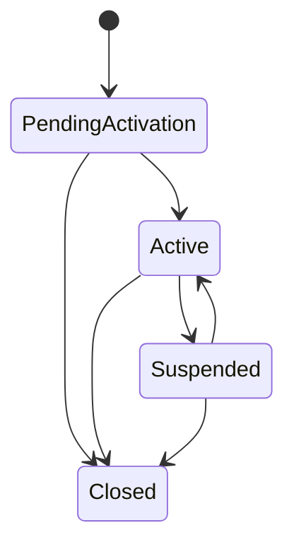

| Current | Next | Authorized actor | Trigger | Preconditions and validation | Effects | Invalid or failed action |
| --- | --- | --- | --- | --- | --- | --- |
| [*] | PendingActivation | Applicant / Identity | Register | Eligible role and unique identifier | Create account and activation challenge | Conflict or return an eligible outstanding challenge under policy |
| PendingActivation | Active | Account holder / Identity | Verify activation | Proof matches account, purpose and expiry | Consume proof and record activation | Expired proof preserves state and offers permitted reissue |
| PendingActivation | Closed | Authorized Identity operator | Close pending registration | Policy permits closure and evidence is retained appropriately | Invalidate pending proof | Hold or dependency blocks disposition |
| Active | Suspended | Authorized staff | Suspend | Scoped enforcement authority and recorded reason | Restrict new actions and recheck sessions | Unrelated role cannot suspend |
| Suspended | Active | Authorized staff | Reinstate | Approved appeal or resolved cause and current eligibility | Record decision and recompute grants | Unresolved reason keeps suspension |
| Active,Suspended | Closed | Authorized Identity operator | Close account | Policy, obligations and holds checked | Revoke account access and retain required evidence | Open cases route to authorized disposition |

## Verification Request

**Related decisions:** D-003/011. **Use cases:** UC-03.

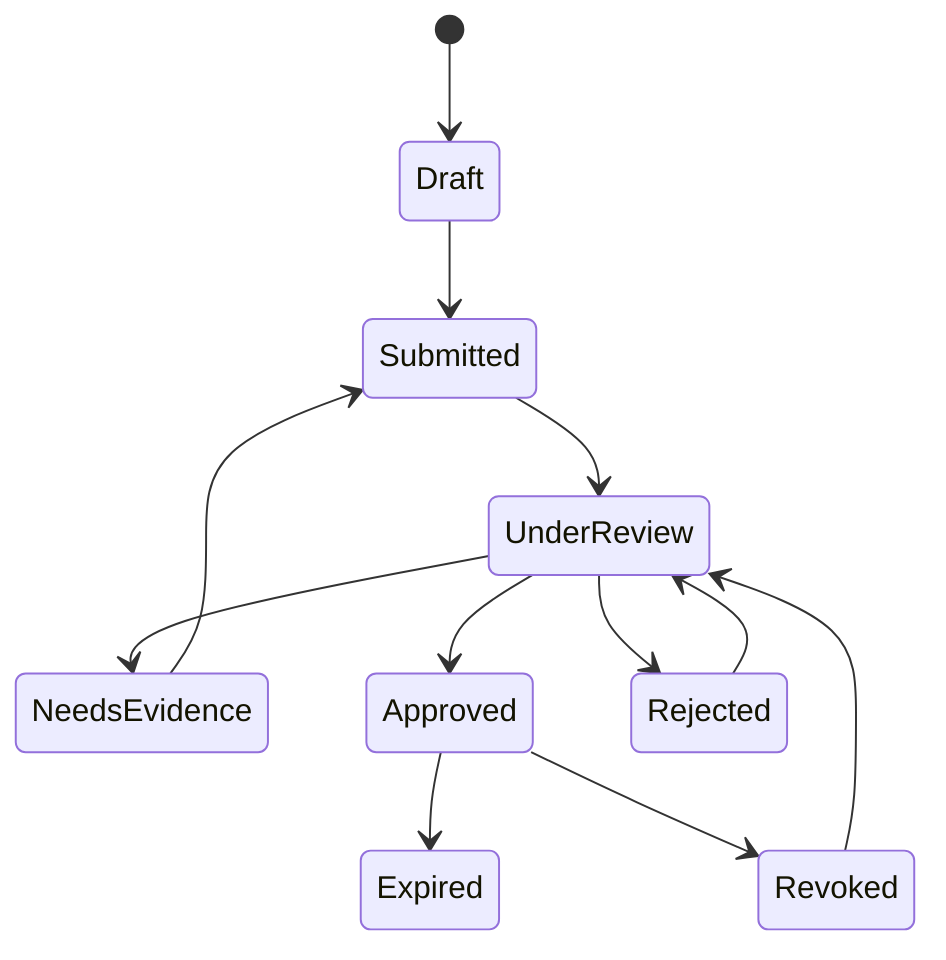

| Current | Next | Authorized actor | Trigger | Preconditions and validation | Effects | Invalid or failed action |
| --- | --- | --- | --- | --- | --- | --- |
| [*] | Draft | Editor | Prepare application | Eligible account and configured criteria version | Record specialty and draft | Missing criteria prevents protected submission |
| Draft,NeedsEvidence | Submitted | Editor | Submit evidence | Current eligible request with inspected required evidence | Snapshot evidence and queue review | Unsafe or incomplete evidence preserves current state |
| Submitted | UnderReview | Verification Specialist | Start review | Assigned scope and conflict checks pass | Record reviewer and review start | Unauthorized claim denied |
| UnderReview | NeedsEvidence | Verification Specialist | Request evidence | Applicable deficiency and allowed next step | Notify applicant with permitted reason | Duplicate action returns prior request |
| UnderReview | Approved,Rejected | Verification Specialist | Decide | Criteria, evidence and reason recorded | Publish specialty status and audit decision | Missing rationale or stale assignment denies decision |
| Rejected,Revoked | UnderReview | Authorized reviewer | Accept appeal | Policy permits appeal and independent assignment where applicable | Record history and open re-review | Rejected appeal intake preserves prior status |
| Approved | Expired,Revoked | Authorized reviewer / scheduler | Expire or revoke | Configured expiry or authorized documented finding | Update badge eligibility and notify | Existing work follows D-003 rather than automatic cancellation |

## Job

**Related decisions:** D-003/004/017. **Use cases:** UC-04, UC-06.

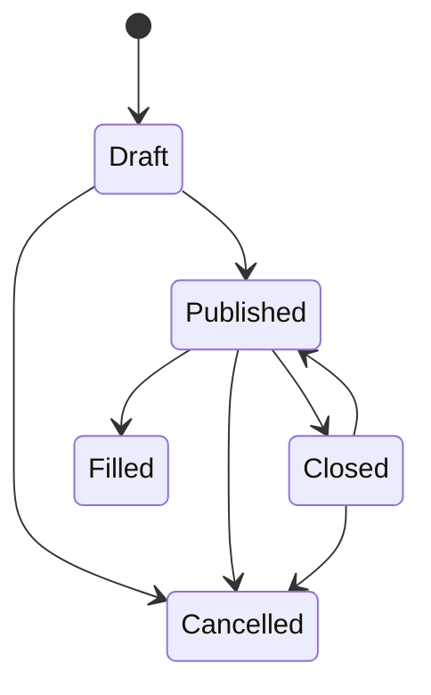

| Current | Next | Authorized actor | Trigger | Preconditions and validation | Effects | Invalid or failed action |
| --- | --- | --- | --- | --- | --- | --- |
| [*] | Draft | Creator | Save draft | Eligible account and ownership | Assign origin and private status | Return field errors for invalid input |
| Draft | Published | Creator | Publish | Approved brief fields complete | Expose to eligible audience | Keep private if validation fails |
| Published | Closed | Creator / scheduler | Close applications | Owner action or deadline | Stop new proposals | Late proposals are rejected regardless of listing cache |
| Published | Filled | Marketplace | Commit single hire | Eligible winning offer and matching intake | Record winning commitment atomically | Competing commits return conflict or prior identical result |
| Draft,Published,Closed | Cancelled | Creator / authorized Operations | Cancel intake | Policy permits and there is no conflicting valid commitment | Preserve linked history | Committed project routes to project cancellation |
| Closed | Published | Creator | Reopen | Explicit policy allows extension and current scope is valid | Restore application eligibility | Otherwise link a separate reposted Job |

## Application

**Related decisions:** D-003/004. **Use cases:** UC-04, UC-06.

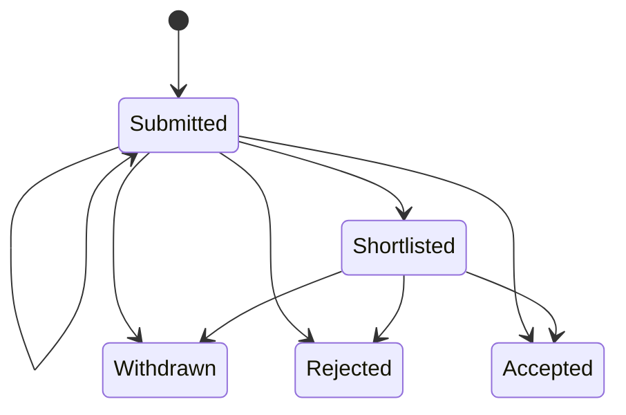

| Current | Next | Authorized actor | Trigger | Preconditions and validation | Effects | Invalid or failed action |
| --- | --- | --- | --- | --- | --- | --- |
| [*] | Submitted | Verified Editor | Apply | Job open, eligible specialty and no duplicate active proposal | Record proposal terms and timestamp | Return conflict or prior identical result |
| Submitted | Submitted | Editor | Edit proposal | Policy allows edit, current version matches and uncommitted | Record revised terms | Stale edit is rejected |
| Submitted,Shortlisted | Withdrawn | Editor | Withdraw | Owner and current state eligible | Record reason if required and close proposal | Committed offer follows cancellation policy |
| Submitted | Shortlisted | Creator | Shortlist | Job ownership and eligible status | Record status for participants | No work or payment permission arises |
| Submitted,Shortlisted | Rejected | Creator / Marketplace | Reject or close competing proposal | Owner decision or configured closure policy | Record reason or closure context | Preserve already accepted result |
| Submitted,Shortlisted | Accepted | Marketplace | Commit offer | Both parties confirm effective commercial intent and winning slot | Link project origin | Competing acceptance preserves winning slot |

## Service Listing

**Related decisions:** D-003/017. **Use cases:** UC-05.

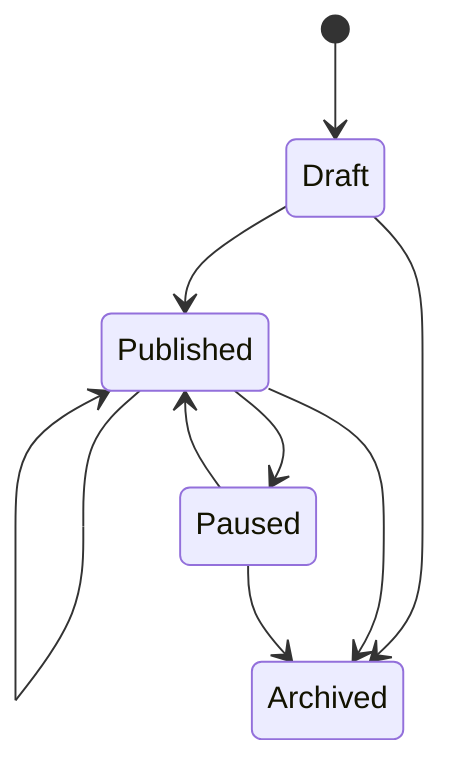

| Current | Next | Authorized actor | Trigger | Preconditions and validation | Effects | Invalid or failed action |
| --- | --- | --- | --- | --- | --- | --- |
| [*] | Draft | Editor | Create Service | Eligible editing profile | Record draft and owner | Owner-only draft access |
| Draft,Paused | Published | Verified Editor | Publish or resume | Relevant current verification and complete offer terms | Expose current offer version | Insufficient eligibility keeps listing private |
| Published | Published | Verified Editor | Update offer | Valid revision and current listing version | Preserve older offer version and existing requests | Requote or close stale requests according to policy |
| Published | Paused | Editor / eligibility service | Pause or suspend | Owner request or eligibility change | Remove from new requests | Existing requests reviewed under policy |
| Draft,Published,Paused | Archived | Editor / authorized staff | Archive | Allowed owner or scoped authority | Stop new requests and retain prior facts | Existing commitments enter project policy |

## Service Request

**Related decisions:** D-003/004/017. **Use cases:** UC-05, UC-06.

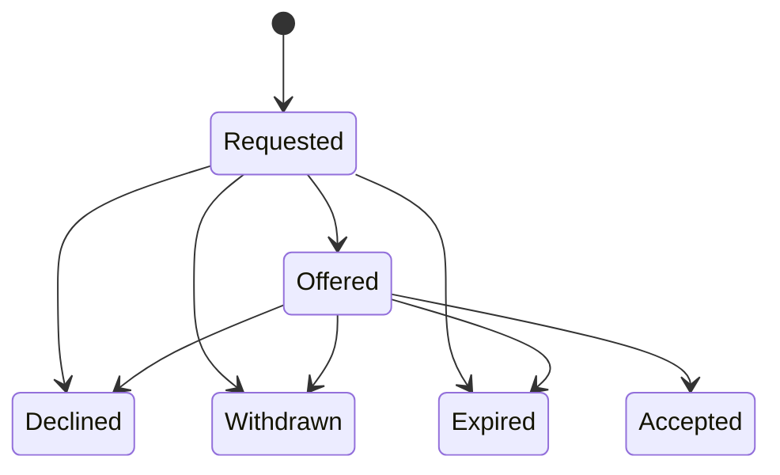

| Current | Next | Authorized actor | Trigger | Preconditions and validation | Effects | Invalid or failed action |
| --- | --- | --- | --- | --- | --- | --- |
| [*] | Requested | Creator | Request Service | Eligible current listing and offer version | Record request scope and price basis | Archived or stale listing causes conflict |
| Requested | Offered | Verified Editor | Propose terms | Assigned listing owner and eligible open request | Record immutable proposal version | Material change requires Creator review |
| Requested,Offered | Declined,Withdrawn,Expired | Editor / Creator / scheduler respectively | Decline, withdraw or expire | Corresponding actor and policy permit action | Record outcome and close pending intent | An accepted request routes to project cancellation |
| Offered | Accepted | Marketplace | Commit offer | Current effective offer and unique commitment for request | Create traceable project once | Concurrent, stale and replayed commands cannot add a project |

## Agreement

**Related decisions:** D-004/010/012. **Use cases:** UC-07.

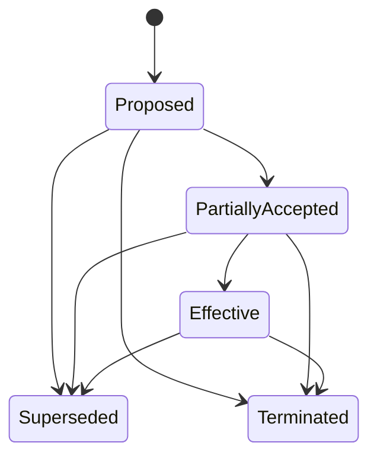

| Current | Next | Authorized actor | Trigger | Preconditions and validation | Effects | Invalid or failed action |
| --- | --- | --- | --- | --- | --- | --- |
| [*] | Proposed | Parties via Agreements | Prepare version | Valid commitment, required terms and fees | Record immutable version and present to parties | Missing required content blocks presentation |
| Proposed | PartiallyAccepted | Creator or Editor | Accept version | Eligible distinct party, current version | Record actor and timestamp | A retry returns prior acceptance |
| PartiallyAccepted | Effective | Other party | Accept same version | Current version and first acceptance still valid | Publish effective terms and funding obligation conditions | Stale input requires current terms |
| Proposed,PartiallyAccepted | Superseded | Agreement coordinator | Replace draft terms | Allowed amendment references prior version | Preserve exact earlier terms and signatures | Old acceptance cannot carry forward |
| Effective | Superseded | Agreement coordinator | Apply effective amendment | Replacement version accepted by both parties and applicable terms satisfied | Advance effective version and re-evaluate work and funding guards | Pending amendment leaves current agreement effective under policy |
| Proposed,PartiallyAccepted,Effective | Terminated | Agreement coordinator | Record authorized cancellation | Project policy allows termination with approved settlement handling | Retain contractual evidence | No inferred financial reversal |

## Project

**Related decisions:** D-004–007/010. **Use cases:** UC-06, UC-07, UC-12, UC-14.

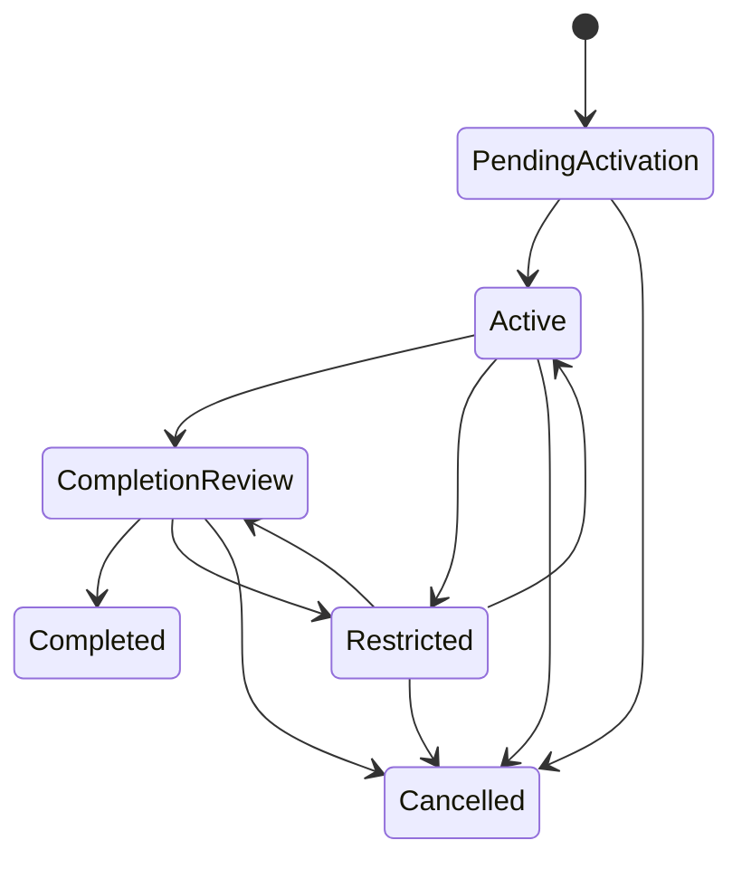

| Current | Next | Authorized actor | Trigger | Preconditions and validation | Effects | Invalid or failed action |
| --- | --- | --- | --- | --- | --- | --- |
| [*] | PendingActivation | Marketplace coordinator | Record accepted offer | One unique Job or Service Request commitment | Create identifiable inactive project | Retry returns existing link |
| PendingActivation | Active | Project coordinator | Activate work | Effective agreement, matching trusted funding, eligible scope and no blocking condition | Grant work access according to policy and emit activation | Uncertain funding leaves state unchanged |
| Active | CompletionReview | Project coordinator | Check completion | Required delivery outcomes recorded and outstanding obligations evaluated | Record readiness and required checks | Open dispute or pending condition holds eligibility when policy requires |
| CompletionReview | Completed | Project coordinator | Apply completion | All approved delivery and financial predicates satisfied | Emit one completion and evaluate review eligibility independently | Late repeat returns completion; reversals are recorded separately |
| Active,CompletionReview | Restricted | Authorized Operations via Projects | Apply documented restriction | Authorized case decision and applicable policy | Scope sensitive work and case access | Pending case alone does not imply restriction |
| Restricted | Active,CompletionReview | Project coordinator | Resume | Resolve reason and re-evaluate stored prior stage and guards | Restore only allowed work permissions | Unresolved condition leaves restriction |
| PendingActivation,Active,CompletionReview,Restricted | Cancelled | Project coordinator | Finalize allowed cancellation | Validated case or policy path and authorized outcome | Preserve evidence and request eligible follow-up | No automatic financial reversal or silent state reset |

## Milestone

**Related decisions:** D-007/005. **Use cases:** UC-07, UC-10, UC-14.

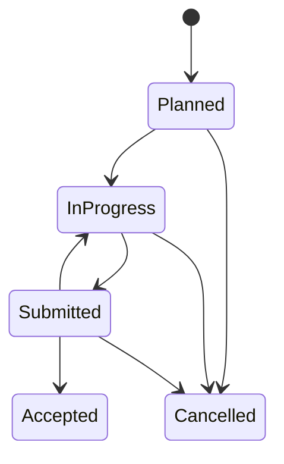

| Current | Next | Authorized actor | Trigger | Preconditions and validation | Effects | Invalid or failed action |
| --- | --- | --- | --- | --- | --- | --- |
| [*] | Planned | Project coordinator | Create milestone | Feature enabled and effective milestone terms | Record scope, due date and conditional obligation | Tracking-only milestone has no financial obligation |
| Planned | InProgress | Project coordinator | Open milestone work | Project authorized and milestone funding condition satisfied where applicable | Grant authorized scope | No work access while funding required and unconfirmed |
| InProgress | Submitted | Editor | Submit milestone output | Inspected delivery and assigned scope | Link exact version and notify | Unsafe or unauthorized upload is not submitted |
| Submitted | Accepted,InProgress | Creator / authorized reviewer | Accept or request revisions | Current reviewable version and allowance | Record decision and advance or resume work | Stale decision is rejected |
| Planned,InProgress,Submitted | Cancelled | Project coordinator | Cancel milestone | Policy permits and project implications assessed | Retain accepted scope evidence and route payment consequences | Cancellation of an accepted output requires case policy |

## Deliverable

**Related decisions:** D-006/011/013. **Use cases:** UC-10, UC-11.

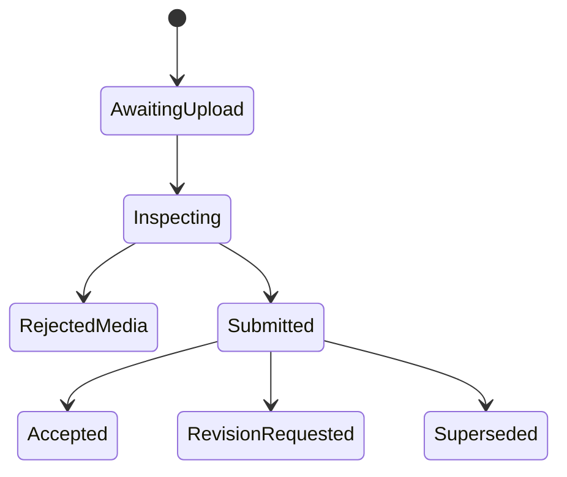

| Current | Next | Authorized actor | Trigger | Preconditions and validation | Effects | Invalid or failed action |
| --- | --- | --- | --- | --- | --- | --- |
| [*] | AwaitingUpload | Editor / Delivery | Start authorized upload | Assigned active scope and permitted file type | Issue scoped upload grant | Unrelated actor denied |
| AwaitingUpload | Inspecting | Delivery | Receive completed upload | File reference and request match | Queue media inspection | Incomplete transfer remains unsubmitted |
| Inspecting | RejectedMedia,Submitted | Delivery | Apply inspection result | Trusted inspection and current grant | Publish version only after clean inspection and authorized submit request | Keep unsafe files isolated and apply retention |
| Submitted | Accepted,RevisionRequested | Creator / authorized reviewer | Review version | Exact version is current and applicable policy permits action | Record version-specific decision | Concurrent decision uses version conflict or prior result |
| Submitted | Superseded | Delivery | Replace version for review | Agreed policy permits replacement and new version authorized | Retain original evidence | Accepted version changes require amendment or case policy |

## Revision

**Related decisions:** D-006. **Use cases:** UC-11.

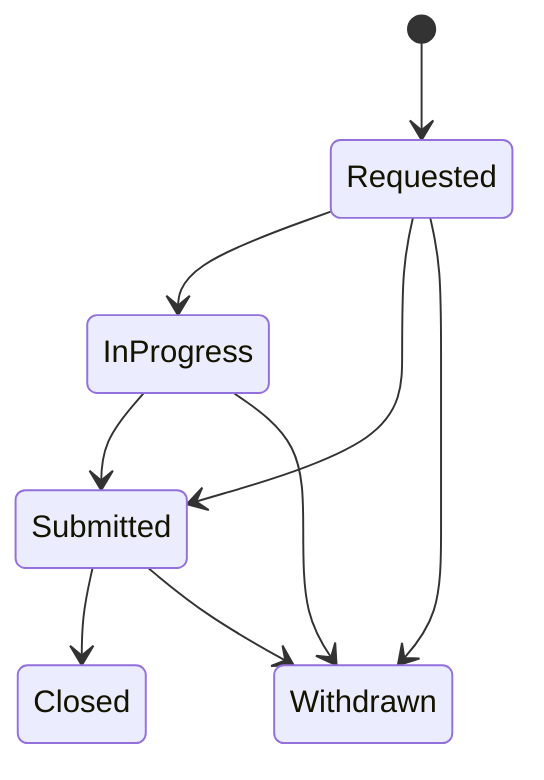

| Current | Next | Authorized actor | Trigger | Preconditions and validation | Effects | Invalid or failed action |
| --- | --- | --- | --- | --- | --- | --- |
| [*] | Requested | Creator | Request revision | Reviewable version and valid request scope and allowance | Record request against version and claim allowance according to policy | Out-of-scope work routes to amendment or dispute |
| Requested | InProgress | Editor | Begin revision | Current work eligibility and recorded request | Record progress | Access restriction delays action |
| Requested,InProgress | Submitted | Editor | Submit replacement | Inspected new version linked to revision | Record resulting version | Invalid media keeps current revision open |
| Submitted | Closed | Delivery | Record resolved revision | Approved decision on resulting version | Close request with traceable decision | Later change uses a new allowed request |
| Requested,InProgress,Submitted | Withdrawn | Creator / authorized reviewer | Withdraw revision | Policy permits withdrawal and treatment of allowance defined | Record withdrawal and history | Do not reuse allowance without policy |

## Payment Attempt

**Related decisions:** D-005/010/012. **Use cases:** UC-08, UC-09, UC-13.

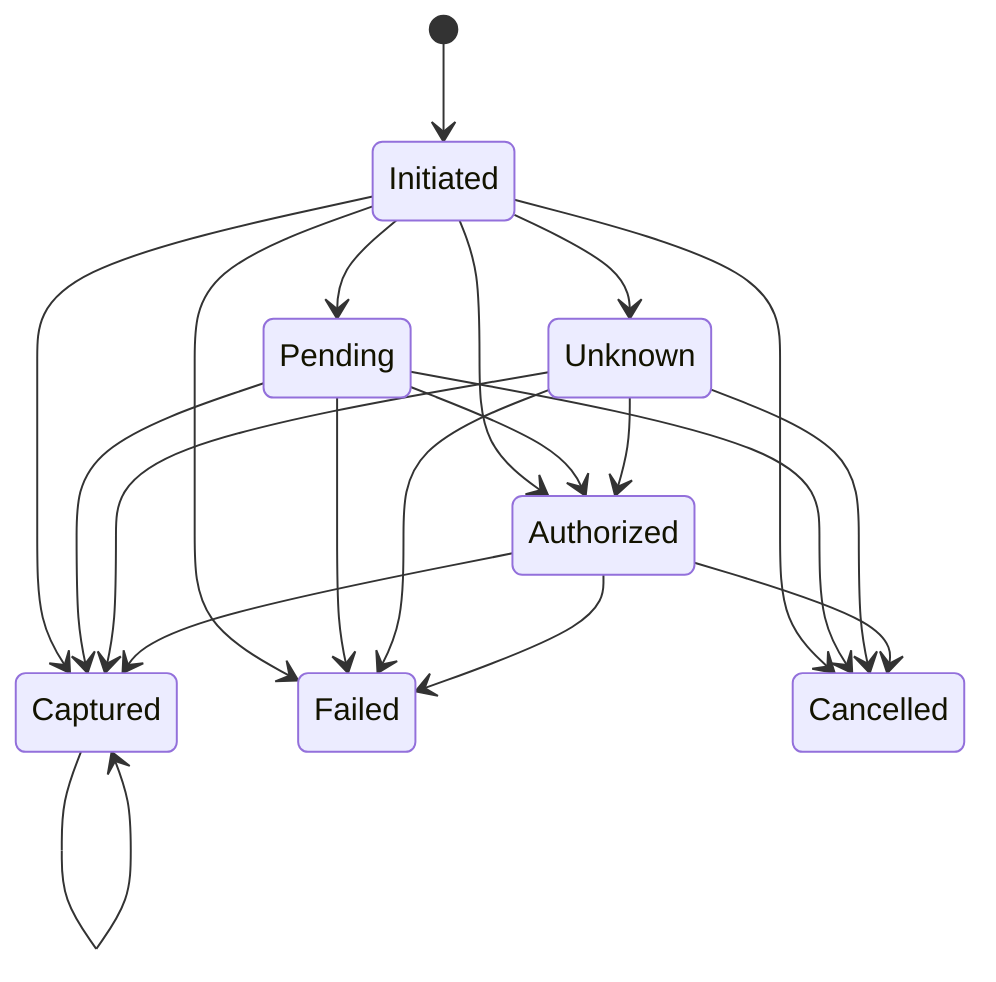

| Current | Next | Authorized actor | Trigger | Preconditions and validation | Effects | Invalid or failed action |
| --- | --- | --- | --- | --- | --- | --- |
| [*] | Initiated | Creator via Payments | Start payment | Effective obligation, matching amount and live or synthetic gate | Reserve stable operation identity | Return pending prior operation or reconcile ambiguity |
| Initiated | Pending,Unknown | Payments | Call provider or await action | Stable operation and authoritative result absent | Persist provider reference if available and pending detail | Retry with same operation identity where supported |
| Initiated,Pending,Unknown | Authorized,Captured,Failed,Cancelled | Verified provider / reconciling reviewer | Confirm payment outcome | Validated event and provider transition with matching obligation | Record outcome once and emit eligible funding fact if policy supports it | Conflicts and unrecognized status go to reconciliation |
| Authorized | Captured,Cancelled,Failed | Verified provider / reconciling reviewer | Confirm capture, void or failure | Approved provider model and valid prior authorization | Record outcome and reassess funding condition | Expiry or stale events cannot revive attempt |
| Captured | Captured | Payments | Observe later refund or chargeback | Trusted event and separate financial operation | Record linked financial adjustment and policy consequences | Preserve original capture evidence |

## Refund

**Related decisions:** D-005/006/008/010. **Use cases:** UC-12, UC-13.

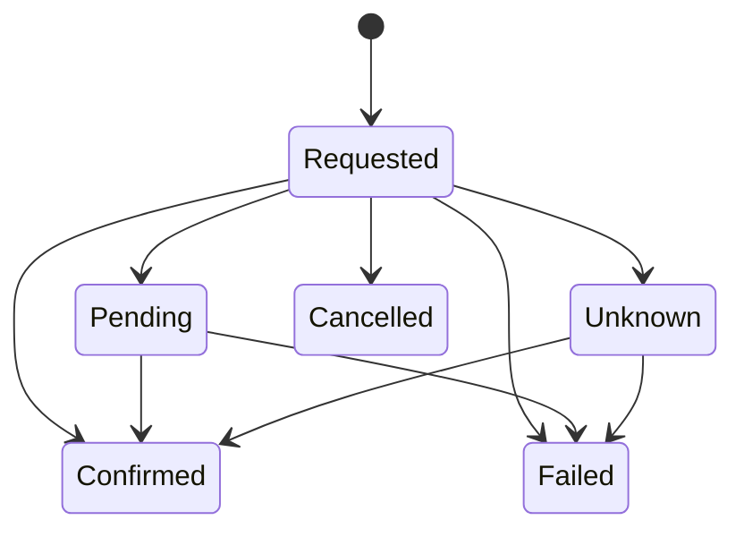

| Current | Next | Authorized actor | Trigger | Preconditions and validation | Effects | Invalid or failed action |
| --- | --- | --- | --- | --- | --- | --- |
| [*] | Requested | Authorized Financial Reviewer | Request refund | Eligible payment, permitted amount, supported action and role | Reserve amount and record reason and stable operation identity | Reject excess or duplicate amount |
| Requested | Pending,Unknown | Payments | Submit to provider | Required approvals and matching operation | Record execution attempt | Ambiguous outcome retains reservation until reconciled |
| Requested,Pending,Unknown | Confirmed,Failed | Verified provider / reconciling reviewer | Confirm refund outcome | Matching evidence and valid transition | Record confirmed reversal or safely release failed reservation | Do not release reservation on timeout alone |
| Requested | Cancelled | Authorized Financial Reviewer | Cancel unexecuted request | No provider execution has started and policy permits | Release eligible reservation and retain history | Pending outcomes require reconciliation |

## Settlement

**Related decisions:** D-005/006/010. **Use cases:** UC-09, UC-13.

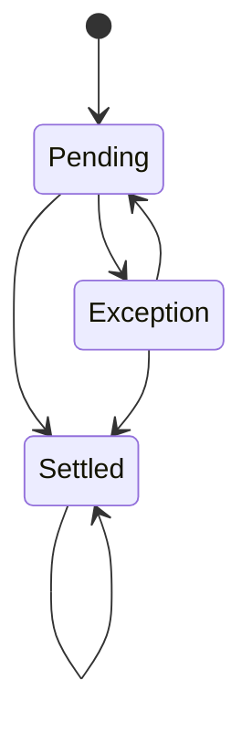

| Current | Next | Authorized actor | Trigger | Preconditions and validation | Effects | Invalid or failed action |
| --- | --- | --- | --- | --- | --- | --- |
| [*] | Pending | Payments | Track expected settlement | Approved provider model and identified monetary obligation | Record provider references or expected allocation | Unsupported conditional settlement remains disabled |
| Pending | Settled,Exception | Verified provider / reconciling reviewer | Record settlement result | Authoritative reports with matching amount, currency and reference | Record allocation or queue mismatch | No payout inferred from settlement |
| Exception | Pending,Settled | Authorized Financial Reviewer | Resolve settlement exception | Supported reconciliation evidence | Record resolution and restore follow-up if pending | Unknown discrepancy stays open |
| Settled | Settled | Payments | Record adjustment | Trusted reversal or settlement correction | Append adjustment with linkage | Preserve previous settlement fact |

## Payout

**Related decisions:** D-005/008/010. **Use cases:** UC-09, UC-13.

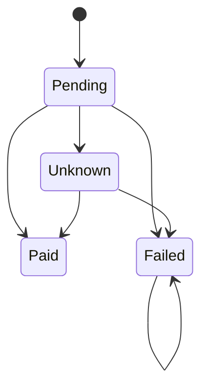

| Current | Next | Authorized actor | Trigger | Preconditions and validation | Effects | Invalid or failed action |
| --- | --- | --- | --- | --- | --- | --- |
| [*] | Pending | Verified provider / Payments | Track expected payout | Eligible earnings and approved recipient / provider rules | Record expected payout and references | Ineligible KYC or unresolved balance blocks initiation |
| Pending | Paid,Failed,Unknown | Verified provider / reconciling reviewer | Update payout outcome | Trusted status matches payout identity | Record separate payout result and notify scoped user | Conflicting records queue reconciliation |
| Unknown | Paid,Failed | Authorized Financial Reviewer | Reconcile unknown payout | Authoritative provider report | Confirm or fail operation without duplicate transfer | Unknown remains open until resolved |
| Failed | Failed | Payments | Authorize new eligible attempt | Prior failure confirmed and retry allowed | Link distinct replacement operation | Do not retry transfer with unresolved prior outcome |

## Dispute

**Related decisions:** D-006/008/011. **Use cases:** UC-12.

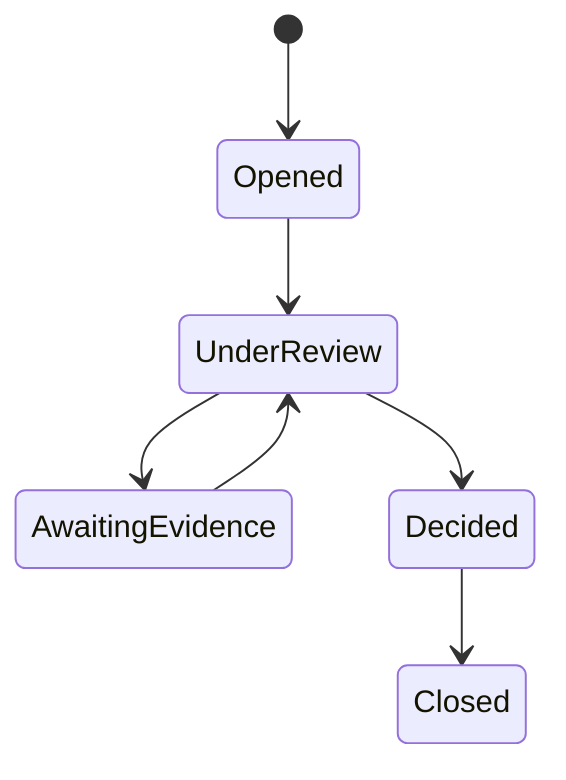

| Current | Next | Authorized actor | Trigger | Preconditions and validation | Effects | Invalid or failed action |
| --- | --- | --- | --- | --- | --- | --- |
| [*] | Opened | Participant / Customer Service | Submit qualifying dispute | Eligible project, party, reason and policy window | Create case and preserve private evidence | Invalid eligibility routes to support if allowed |
| Opened | UnderReview | Authorized case reviewer | Take assignment | Permitted scope and issue category | Record responsibility and notify permitted parties | Unassigned reviewers cannot resolve case |
| UnderReview | AwaitingEvidence,Decided | Authorized case reviewer | Request evidence or decide | Policy, documented rationale and role scope | Record chosen next step or remedy recommendation | No unilateral payment mutation |
| AwaitingEvidence | UnderReview | Assigned reviewer | Resume review | Requested evidence or recorded time limit | Record preserved response and next review | Late evidence handled by policy |
| Decided | Closed | Assigned Operations reviewer | Close dispute | Required actions completed or formally handed off | Retain case history and outcome | Open provider remedy remains visible |

## Support Ticket

**Related decisions:** D-002/008/011. **Use cases:** UC-15.

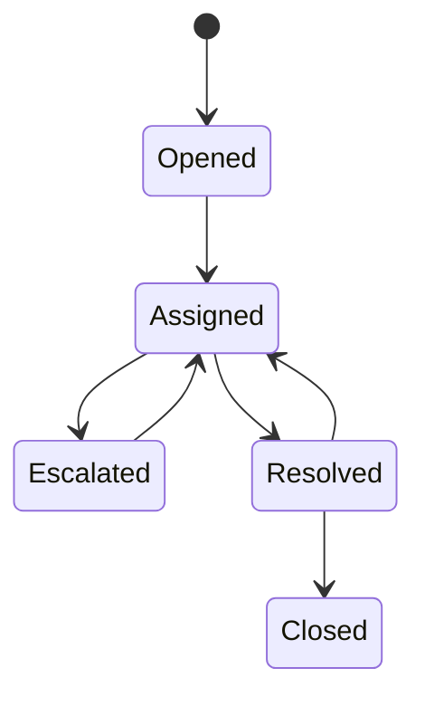

| Current | Next | Authorized actor | Trigger | Preconditions and validation | Effects | Invalid or failed action |
| --- | --- | --- | --- | --- | --- | --- |
| [*] | Opened | User / staff intake | Open ticket | Permitted category and actor | Assign reference and accountable queue | Sensitive details are restricted |
| Opened,Escalated | Assigned | Authorized queue owner | Assign ticket | Scoped queue, assignee and category match | Record owner and history | Failed handoff keeps existing owner |
| Assigned | Escalated | Assigned support agent | Escalate | Approved recipient or urgent route and reason | Preserve owner and routing history | Ordinary scope does not grant emergency access |
| Assigned | Resolved | Assigned support agent | Resolve | Permitted resolution and notes | Record resolution and notify participant | Open dependent issue keeps ticket assigned |
| Resolved | Closed,Assigned | Authorized agent | Close or reopen | Approved confirmation or reopening policy | Persist outcome and ownership | Reopened case retains prior evidence |

## Moderation Case

**Related decisions:** D-002/008/011. **Use cases:** UC-16.

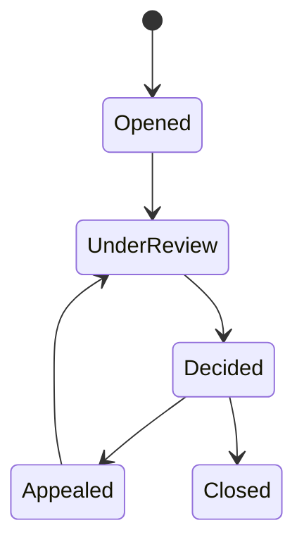

| Current | Next | Authorized actor | Trigger | Preconditions and validation | Effects | Invalid or failed action |
| --- | --- | --- | --- | --- | --- | --- |
| [*] | Opened | User / Moderator | Report content | Permitted target and evidence | Create scoped case | Duplicate reports may link to existing case under policy |
| Opened | UnderReview | Moderator | Take review | Assigned scope and available guidelines | Record reviewer and trace | Sensitive evidence restricted |
| UnderReview | Decided | Moderator | Decide | Authorized action and recorded rationale | Apply permitted enforcement and notify affected parties | Financial action requires separate case path |
| Decided | Appealed,Closed | Affected user / Moderator respectively | Appeal or close | Applicable deadline and actor | Record new review request or closure | Late appeal follows policy |
| Appealed | UnderReview | Authorized appellate reviewer | Assign re-review | Scoped appellate assignment and conflict check | Retain prior decision | Unassigned reviewer cannot change enforcement |

## Diwan Record

**Related decisions:** D-002/008/011. **Use cases:** UC-18.

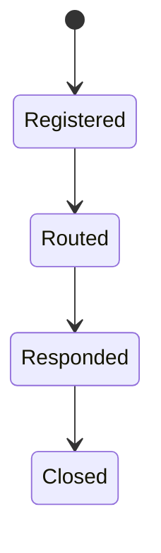

| Current | Next | Authorized actor | Trigger | Preconditions and validation | Effects | Invalid or failed action |
| --- | --- | --- | --- | --- | --- | --- |
| [*] | Registered | Correspondence Officer | Register official item | Enabled function and permitted classification | Create reference and restricted attachments | Duplicate reference prompts resolution |
| Registered | Routed | Correspondence Officer | Route item | Authorized recipient and applicable due date | Record responsible owner and acknowledgment | Urgent legal intake uses approved route |
| Routed | Responded | Assigned owner | Record response | Approved response authority and evidence | Preserve response fact and routing history | A legal determination stays with counsel |
| Responded | Closed | Authorized Diwan staff | Close item | Policy, classification and holds checked | Retain history and disposition schedule | Legal hold blocks unauthorized disposition |

## Chargeback

**Related decisions:** D-005/006/008/010. **Use cases:** UC-13.

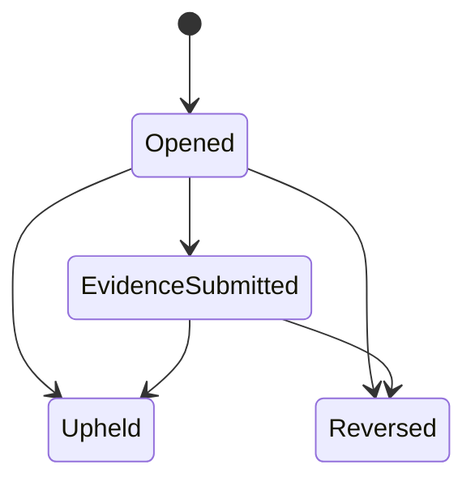

| Current | Next | Authorized actor | Trigger | Preconditions and validation | Effects | Invalid or failed action |
| --- | --- | --- | --- | --- | --- | --- |
| [*] | Opened | Verified provider / Payments | Ingest provider claim | Matches original payment and trusted source | Record separate claim and applicable exposure | Unknown reference enters reconciliation |
| Opened | EvidenceSubmitted | Authorized Financial Reviewer | Submit permitted evidence | Approved response window and scope | Record submission reference | Expired window follows provider policy |
| Opened,EvidenceSubmitted | Upheld,Reversed | Verified provider / reconciling reviewer | Record provider resolution | Authoritative resolution and matching currency, amount and claim identity | Record any financial adjustment and review/reporting impact once | Conflicting evidence remains pending reconciliation |

## Review

**Related decisions:** D-006/008. **Use cases:** UC-14, UC-16.

```mermaid
stateDiagram-v2
    direction TB
    [*] --> Submitted
    Submitted --> Published
    Submitted --> Hidden
    Published --> Hidden
    Hidden --> Published
```

| Current | Next | Authorized actor | Trigger | Preconditions and validation | Effects | Invalid or failed action |
| --- | --- | --- | --- | --- | --- | --- |
| [*] | Submitted | Creator or Editor | Submit review | Qualifying participant, transaction and uniqueness predicate | Store review and policy eligibility reference | Reject unrelated or duplicate review |
| Submitted | Published,Hidden | Reviews / scoped moderator | Apply publication decision | Applicable publication and visibility rule | Record status and reason where required | An ineligible result remains restricted |
| Published | Hidden | Scoped moderator / Reviews | Hide or reassess | Authority and approved moderation or later reversal policy | Retain original history | Do not delete case evidence |
| Hidden | Published | Authorized appellate reviewer | Restore visibility | Following authorized appeal and current policy | Record decision and scoped publication | Hold remains if requirement unmet |

## Change history

| Version | Date | Change |
| --- | --- | --- |
| 0.3.0 | 2026-11-24 | Defined 21 lifecycle models and 172 permitted directed transitions |
